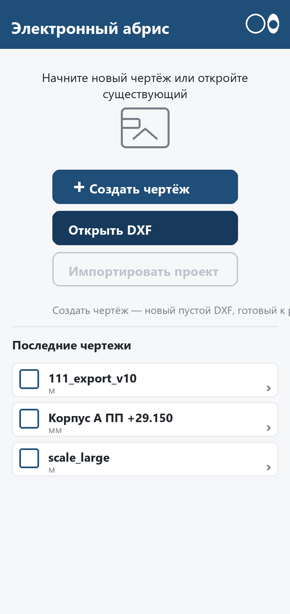

[](https://github.com/negony/menzulka/actions/workflows/ci.yml)

# Мензулка

**Мензулка** — электронный абрис для геодезиста: чертёж DXF/DWG, точки с фото и
голосовыми заметками, измерения, координаты X/Y/H, рисование на плане и на
фотографии — офлайн, на телефоне и на компьютере.

Платформы: **Android** (7.0+) и **Windows** (10/11 x64). Интерфейс на русском.

**Скачать:** [Releases](https://github.com/negony/menzulka/releases) (APK и установщик).
**Исходный код:** <https://github.com/negony/menzulka> — есть и в приложении («О программе»).



## Что умеет

- **Чертежи DXF и DWG** — все основные примитивы (линии, полилинии с дугами,
  дуги, окружности, эллипсы, сплайны, текст, блоки, размеры, выноски), слои,
  цвета ACI/true color, веса линий; панорама и зум.
  **DWG** версий R12–R2018 (AC1009–AC1032) читается встроенным нативным модулем,
  офлайн; при чтении вырезаются «мёртвые» блоки без вставок — большой чертёж
  51 МБ открывается за ~30 с на телефоне.
- **Пять режимов**: Обзор, Координаты, Точка, Измерить, Рисование.
- **Привязки**: конечная точка, узел, пересечение, перпендикуляр, касательная,
  ближайшая — к чертежу и нарисованному, включая блоки; ортогональное и угловое
  черчение (45°…5°); лупа при удержании.
- **Точки**: номер, код, описание, X/Y/Z, фотографии, голосовые заметки, история
  точки; список с поиском, фильтром, массовым и свайп-удалением.
- **Фотографии**: камера или файл; рисование поверх снимка (карандаш, линия,
  прямоугольник, круг, стрелка, текст; отмена, ластик по объекту, очистка;
  сохранение с заменой или как новое фото).
- **Измерения**: расстояние, ломаная, замкнутый контур (периметр и площадь),
  подписи длин, история с фильтрами.
- **Координаты X, Y, H**: H берётся из объекта чертежа (Z из DXF); копирование
  X,Y и создание точки по координатам.
- **Рисование**: точка, полилиния, отрезок, прямая, круг, прямоугольник, облако,
  текст, размер; 5 толщин, 8 цветов, 4 высоты текста; слои рисунков; правка
  объектов (перемещение, поворот, масштаб текста, изменение, удаление).
- **Экспорт и перенос**: DXF, «DXF + фото (ZIP)», пакет проекта `.abris`
  («Поделиться» / «Сохранить в файл»), импорт `.abris`.
- **История и версии**: журнал событий с поиском, версии проекта (до 20).
- **Офлайн-хранение**: SQLite (drift) и файлы фото/аудио в каталоге документов.

## Управление

| Телефон | Компьютер |
|---|---|
| Касание — точка/вершина, выбор, координата | Левая кнопка — рисование, выбор |
| Удержание — лупа и привязки | Правая кнопка — завершить полилинию/облако |
| Два пальца — зум, панорама, поворот/масштаб объекта | Средняя кнопка — панорама |
| Свайп по строке точки — удалить | Колесо мыши — масштаб; уголок рамки текста — поворот |

## Требования

- **Пользователю:** Android 7.0+ (API 24) или Windows 10/11 x64. Дополнительно
  ничего ставить не нужно.
- **Для сборки:** Flutter stable 3.47+ / Dart 3.13+, Visual Studio 2022 (C++),
  Inno Setup 6; для модуля DWG — Rust (rustup) и Android NDK.

## Сборка и запуск

```bash
flutter pub get
powershell -ExecutionPolicy Bypass -File tool/build_native.ps1   # модуль DWG, один раз
flutter run -d windows                 # или: flutter run (Android по USB)

flutter build apk --release            # APK
flutter build windows --release        # exe
iscc installer/windows_installer.iss   # установщик (Inno Setup 6)
```

Без шага `build_native` приложение работает с DXF, а DWG-файл показывает
«Модуль DWG недоступен».

Установщик Windows предлагает режимы: **Установить**, **Обновить**,
**Чистая установка** (с удалением прежней версии) и **Удалить программу**.

## Тесты и CI

```bash
dart format lib test tool
flutter analyze
flutter test        # 226 тестов
cargo test --manifest-path native/Cargo.toml
```

GitHub Actions: анализ, тесты Flutter (Flutter закреплён на 3.47.7) и отдельная
задача `native` — сборка Rust-крейта, тесты и аудит лицензий (`cargo deny`).

## Структура

```
lib/
  models/       DXF-сущности, точки, измерения, фото, аудио, история, версии
  services/     база (drift), парсер DXF, привязки, .abris, DWG-конвертация (FFI)
  screens/      главный экран/чертёж, точки, история, просмотр и правка фото
  widgets/      виджет чертежа и отрисовка, инструменты, слои, панели
  exporters/    экспорт DXF и ZIP с фото
native/         Rust-модуль DWG → DXF (acadrust, MPL-2.0)
android/ windows/ installer/ tool/ test/ docs/
```

## Лицензии

Код приложения — **MIT**, см. [LICENSE](LICENSE).

Чтение DWG выполняет [acadrust](https://github.com/hakanaktt/acadrust) (Rust,
**MPL-2.0**): лицензия распространяется на сам компонент, код «Мензулки» остаётся
под MIT. Проприетарные SDK Autodesk/ODA и GPL-компоненты (LibreDWG) не
используются и не поставляются. Полный список — [THIRD_PARTY_NOTICES.md](THIRD_PARTY_NOTICES.md)
(он же в приложении: «О программе» → «Лицензии компонентов»).
