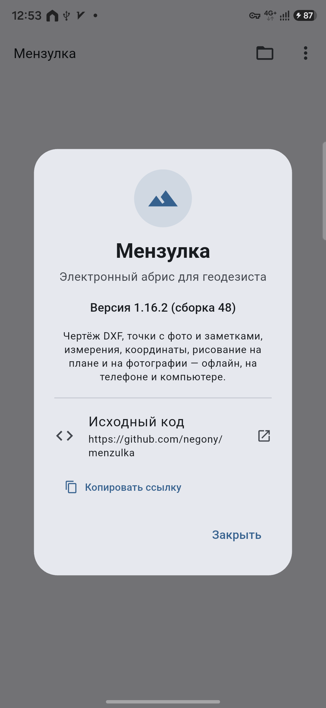

# Мензулка

**Мензулка** — электронный абрис для геодезиста: приложение для работы на объекте.
Открыть DXF-чертёж, поставить точки с
фотографиями и голосовыми заметками, измерить расстояния и площади, снять
координаты, дорисовать недостающее прямо на чертеже или на фотографии — и
передать готовый абрис на компьютер. Работает **офлайн**: все данные хранятся
локально в приложении.

Платформы: **Android** (телефон/планшет) и **Windows** (настольная сборка с
установщиком). Интерфейс на русском языке.

Исходный код: <https://github.com/negony/menzulka> — эта же ссылка есть в приложении
(меню **«О программе»**).


## Содержание

- [Работа с DXF](#работа-с-dxf)
- [Пять режимов](#пять-режимов)
- [Привязки и точность](#привязки-и-точность)
- [Точки (аннотации)](#точки-аннотации)
- [Фотографии](#фотографии)
- [Голосовые заметки](#голосовые-заметки)
- [Измерения](#измерения)
- [Координаты X, Y, H](#координаты-x-y-h)
- [Рисование на чертеже](#рисование-на-чертеже)
- [Слои](#слои)
- [Правка нарисованного](#правка-нарисованного)
- [История и версии](#история-и-версии)
- [Экспорт и перенос проектов](#экспорт-и-перенос-проектов)
- [Хранение данных](#хранение-данных)
- [Управление: жесты и мышь](#управление-жесты-и-мышь)
- [О программе](#о-программе)
- [Требования](#требования)
- [Сборка и запуск](#сборка-и-запуск)
- [Установщик Windows](#установщик-windows)
- [Тесты и CI](#тесты-и-ci)
- [Структура проекта](#структура-проекта)
- [Служебные скрипты](#служебные-скрипты)
- [Лицензия](#лицензия)

## Работа с DXF

- **Просмотр**: LINE, LWPOLYLINE и POLYLINE (с дуговыми сегментами `bulge`),
  ARC, CIRCLE, ELLIPSE, SPLINE, POINT, TEXT/MTEXT, INSERT/BLOCK (рекурсивно),
  SOLID/TRACE/3DFACE, RAY/XLINE, DIMENSION, LEADER.
- **Слои чертежа**: включение/выключение, цвета ACI, «true color» и BYLAYER,
  веса линий; выключенные и замороженные слои не рисуются.
- **Навигация**: панорама и зум двумя пальцами, масштаб колесом мыши (на ПК),
  авто-вписывание чертежа в экран при открытии, плавная работа с большими
  файлами за счёт кэша отрисовки по слоям.
- **Открытие файлов**: «Открыть DXF» в системном проводнике/файловом менеджере;
  «Создать чертёж» — новый пустой чертёж на основе шаблона AutoCAD; список
  последних чертежей на главном экране.

## Пять режимов

Нижняя панель переключает режим работы; в каждом режиме — своя панель действий
над чертежом.

| Режим | Что делает |
|---|---|
| **Обзор** | Просмотр и навигация, выделение нарисованных объектов, слои, настройки привязок, ортогональное и угловое черчение |
| **Координаты** | Снятие координат с примитивов чертежа и нарисованных объектов: X, Y и H |
| **Точка** | Создание точки (аннотации) в месте касания с заполнением карточки |
| **Измерить** | Расстояние, ломаная, замкнутый контур с периметром и площадью |
| **Рисование** | Дорисовка на чертеже: от точки до текста и размеров |

## Привязки и точность

- **Типы привязок**: конечная точка (вершина), узел (точка/вставка блока),
  пересечение, перпендикуляр, касательная, ближайшая точка на примитиве.
- Привязки работают и к объектам **чертежа**, и к **нарисованным** объектам, в
  том числе внутри блоков; в карточке координат виден тип привязки и источник
  («чертёж», «рисунок», «чертёж+рисунок»).
- **Панель «Привязки»**: включение всех привязок и отдельных типов.
- **Ортогональное черчение**: горизонталь/вертикаль от предыдущей точки.
- **Угловая привязка**: шаг 45°, 30°, 20°, 15°, 10° или 5° с индикатором угла
  у курсора.
- **Лупа-увеличитель**: удержание пальца над чертежом открывает увеличение с
  перекрестием — так проще попасть в узел на мелком масштабе.

## Точки (аннотации)

- **Создание**: режим «Точка» → касание места на чертеже. Координаты берутся с
  учётом привязки, номер предлагается автоматически и **редактируется**.
- **Карточка точки**: номер, код, описание, координаты X и Y (можно исправить),
  высота Z, фотографии, голосовые заметки, история изменений точки.
- **Маркеры**: точки подписаны номерами на чертеже; касание маркера открывает
  точку. Если точки стоят в одном месте — лист выбора («Точка №…» или «Новая
  точка здесь»).
- **Список точек**: поиск по номеру/коду/описанию, фильтр «Все / С кодом», режим
  выделения с массовым удалением, удаление свайпом с возможностью отменить.

## Фотографии

- **Добавление**: камера устройства или **выбор файла из проводника/галереи**
  (кнопка «Добавить фото» предлагает оба варианта).
- **Просмотр**: полноэкранный просмотр с зумом и панорамированием.
- **Рисование на фото** (абрис поверх снимка):
  - инструменты: карандаш (свободная линия), линия, прямоугольник, круг,
    стрелка, текст;
  - 6 цветов и 3 толщины;
  - **«Отменить»** — убрать последний объект;
  - **«Ластик»** — нажатие на конкретный нарисованный объект удаляет именно его;
  - **«Очистить»** — убрать весь рисунок (с подтверждением);
  - сохранение: **«Заменить фото»** (рисунок записывается в файл точки) или
    **«Сохранить как новое фото»** (оригинал остаётся);
  - миниатюра в карточке точки сразу показывает результат.

## Голосовые заметки

Запись с микрофона прямо в карточке точки, прослушивание с индикатором
длительности, удаление. Заметки переносятся вместе с проектом `.abris`.

## Измерения

- **Расстояние** — между двумя точками.
- **Ломаная** — длина по последовательности точек.
- **Замкнутый контур** — длина сторон, **периметр** и **площадь**; кнопки
  «Замкнуть/Разомкнуть», «Завершить», «Отменить».
- Подписи длин на каждой стороне, маркер замыкания и сводка в панели.
- **История измерений**: фильтры «Все / Расстояния / Контуры», карточка
  измерения с деталями, удаление измерения, очистка истории целиком.

## Координаты X, Y, H

Режим «Координаты» снимает координаты с объектов чертежа:

- касание или протягивание пальцем по вершинам, узлам, пересечениям и точкам
  примитивов;
- карточка показывает **X**, **Y** и **H** — высота берётся **из самого
  объекта** (Z из DXF: группа 30, у полилиний — 38); у нарисованных объектов
  H = 0, на пустом месте — «—»;
- в карточке видны тип привязки и источник координаты;
- действия: **«Копировать X,Y»** в буфер обмена, **«+ Точка»** (создать точку по
  этим координатам), сброс;
- панорама и зум двумя пальцами, не сбрасывая захваченную точку.

## Рисование на чертеже

- **Инструменты**: точка, полилиния, отрезок, прямая, круг, прямоугольник,
  облако (обвести пальцем), текст и размер (по трём точкам).
- **Оформление**: 5 толщин линии, 8 цветов, 4 варианта высоты текста (выбираются
  в диалоге текста).
- **Живое превью** инструмента и привязки в процессе рисования; на ПК правая
  кнопка мыши завершает полилинию/облако, средняя кнопка панорамирует чертёж.
- **Скольжение одним пальцем** задаёт радиус круга, полку размера и контур
  облака.
- Кнопки **«Завершить»**, **«Отменить»** и **«Удалить последний»**.
- Нарисованное сохраняется в проекте и выгружается в DXF нативными примитивами
  по слоям.

## Слои

Панель **«Слои»** (Обзор и Рисование):

- список слоёв чертежа и слоёв рисунков; видимость переключается чекбоксом —
  объекты остаются в проекте и в экспорте, но не отображаются;
- **активный слой** — в него складываются новые нарисованные объекты;
- **создание нового слоя** («Новый слой» → «Создать»).

## Правка нарисованного

В режиме «Обзор» нарисованный объект (текст, прямоугольник и другие)
выделяется касанием:

- **перемещение** — перетаскиванием одним пальцем (мышью — с зажатой кнопкой);
- **поворот** — двумя пальцами, а у текста ещё и перетаскиванием за
  **уголок-ручку** на рамке выделения (удобно мышью);
- **масштаб текста** — щипком двумя пальцами, без ограничения размера;
- **изменение текста** и **удаление объекта** — панель выделения («Изменить»,
  «Удалить»).

## История и версии

- **Журнал изменений**: события по дате с категориями «Точки», «Фото»,
  «Заметки», «Измерения», «Система» (экспорт/импорт и прочее), поиск по журналу.
- **Версии проекта**: снимки проекта `.abris` (до 20), создание, восстановление
  и удаление версии.
- **История точки**: список изменений конкретной точки в её карточке.

## Экспорт и перенос проектов

- **«Экспорт в DXF…»** (меню «Проект»):
  - режим **«DXF (геометрия)»** — исходные примитивы чертежа плюс нарисованные
    объекты нативными типами по слоям (новые слои добавляются в таблицу LAYER);
  - режим **«DXF + фото (ZIP)»** — тот же DXF, папка `photos/`, `points.csv`
    (номера, X/Y/Z, код, описание) и `README.txt`;
  - опции: «Точки с номерами», «Измерения», «Только видимые слои».
- **«Поделиться проектом»** — пакет `.abris` (DXF + `manifest.json` + `photos/` +
  `audio/`) и передача через системное «Поделиться»; качество фото: «Компактно»,
  «Полное», «Без фото».
- **«Сохранить проект в файл…»** — тот же `.abris` через системный диалог
  «Сохранить как» (без мессенджеров).
- **«Импортировать проект»** — открыть `.abris` и продолжить работу с ним.
- **«Открыть DXF»** — открыть чертёж из файла.

## Хранение данных

- Локальная база **SQLite** (drift): чертежи, точки, фото, заметки, измерения,
  нарисованные объекты, события истории, версии проекта.
- Файлы фотографий и аудиозаписей — в каталоге документов приложения; экспорт —
  во временную папку с последующим «Поделиться»/«Сохранить как».
- Сеть не требуется: приложение полностью работает офлайн.

## Управление: жесты и мышь

**Телефон / планшет**

| Жест | Действие |
|---|---|
| Касание | поставить точку/вершину, выбрать объект, снять координату |
| Удержание | прицел с лупой и привязками |
| Скольжение одним пальцем | радиус круга, полка размера, контур облака, захват координаты |
| Два пальца | зум и панорама; поворот и масштаб выделенного объекта |
| Свайп по строке в списке точек | удалить точку (с отменой) |

**Компьютер**

| Действие | Что делает |
|---|---|
| Левая кнопка | рисование, выбор, работа с панелями |
| Правая кнопка | завершить полилинию/облако |
| Средняя кнопка | панорама чертежа (не рисует) |
| Колесо мыши | масштаб |
| Перетаскивание уголка рамки текста | поворот текста |

## О программе

Пункт меню **«О программе»** (кнопка «⋮» на главном экране и в чертеже) показывает:

- название приложения и его назначение;
- **версию сборки** — версию и номер сборки из настроек пакета (на ПК — из
  ресурсов исполняемого файла, на Android — из манифеста);
- краткое описание возможностей;
- **ссылку на исходный код**: <https://github.com/negony/menzulka> — открывается
  в браузере, рядом кнопка «Копировать ссылку».



## Требования

- **Flutter** stable 3.47+ и **Dart** 3.13+.
- **Android**: Android SDK 36 (targetSdk 36), устройство с отладкой по USB.
- **Windows**: Windows 10/11 x64, Visual Studio 2022 с рабочей нагрузкой
  «Разработка классических приложений на C++».
- **Установщик Windows**: Inno Setup 6.

## Сборка и запуск

```bash
flutter pub get
flutter run                # Android по USB
flutter run -d windows     # Windows
```

## Установщик Windows

```bash
flutter build windows --release
iscc installer/windows_installer.iss     # Inno Setup 6
```

Установщик (файл в `dist/`) при запуске предлагает выбрать режим:

| Режим | Действие |
|---|---|
| **Установить** | обычная установка; файлы существующей версии заменяются |
| **Обновить** | обновление поверх установленной версии, настройки и данные сохраняются |
| **Чистая установка** | сначала удаляется предыдущая установка, затем ставится новая |
| **Удалить программу** | только удаляет приложение и закрывает установщик |

На странице режима показывается уже установленная версия (если она есть).

## Тесты и CI

```bash
dart format lib test tool   # единый стиль кода
flutter analyze             # статический анализ — без замечаний
flutter test                # 200 тестов
```

GitHub Actions (`.github/workflows/ci.yml`): при push в `main`, в pull request и
вручную выполняются `flutter pub get`, проверка `dart format`, `flutter analyze`
и `flutter test`.

## Структура проекта

```
lib/
  models/       модели данных: DXF-сущности, точки, нарисованные объекты,
                измерения, фото, аудио, история, версии, настройки привязок
  services/     база данных (drift), парсер DXF, движок привязок, пакет проекта
                .abris, история и версии, настройки приложения
  screens/      экраны: главный, чертёж, карточка точки, список точек,
                история измерений, история и версии проекта, просмотр и правка
                фото
  widgets/      виджет чертежа (dxf_viewer) и отрисовка: холст, наложения,
                маркеры, привязки, лупа, инструменты рисования, слои, нижняя
                панель режимов
  exporters/    экспорт DXF, ZIP с фото
  utils/        геометрия, цвета ACI, кэш слоёв, фото, оверлеи
assets/         пустой DXF-шаблон AutoCAD
android/        Android-проект (targetSdk 36)
windows/        Windows-раннер
installer/      скрипт установщика Inno Setup
test/           200 тестов: парсер, привязки, рисование, экспорт, интерфейс
tool/           служебные скрипты (иконки, макет, описание, тестовые данные)
docs/           документация и эскизы
```

## Служебные скрипты

- `tool/make_icons.py` — иконки Android (mipmap + adaptive) и Windows (`.ico`).
- `tool/make_mockup.py` — эскиз главного экрана для документации.
- `tool/make_manual_docx.py` — пользовательское описание программы (`.docx`).
- `tool/generate_test_bundle.dart` — тестовый проект с точками и фото.
- `tool/generate_snap_test_dxf.dart` — небольшой DXF для проверки привязок.

## Документация

- `docs/Описание_программы_Мензулка.docx` — пользовательское описание.
- `PROJECT_STATUS.md` — архитектура, принятые решения и особенности реализации.

## Лицензия

MIT — см. [LICENSE](LICENSE).
